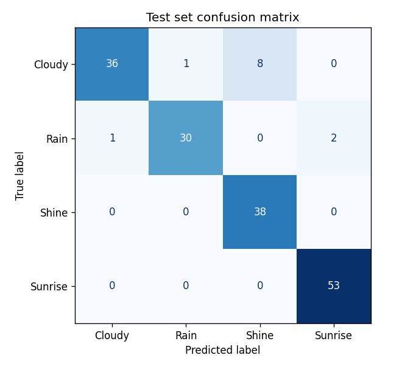
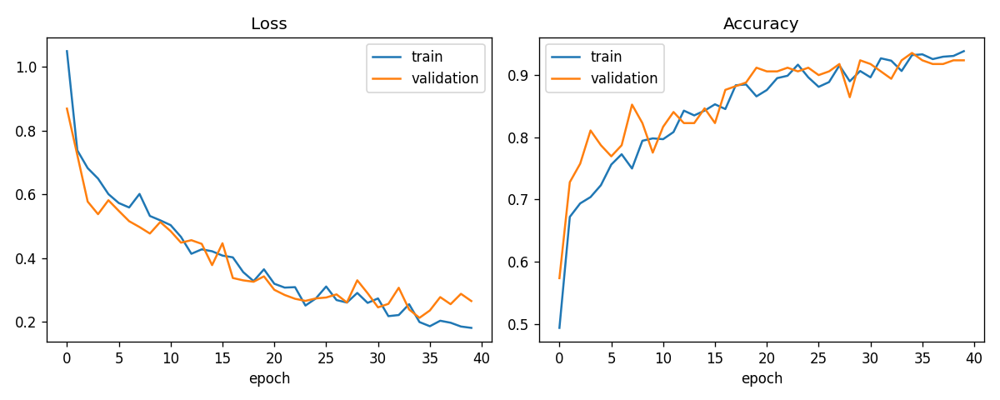

# Climate Vision

**A convolutional neural network that classifies weather photos as Cloudy, Rain, Shine or
Sunrise, served through a Streamlit web app.**

This was my final-year B.Tech team project (four members), and I did most of the development.
After graduating I revisited it: I fixed a modelling bug, evaluated it on a proper held-out test
set, and made the app robust to real-world images.

## Results

The model was evaluated on a **held-out test set of 169 photos** that it never saw during
training or early stopping.

| Metric | Score |
|---|---|
| **Test accuracy** | **92.9%** |
| Macro F1 | 0.925 |

| Class | Precision | Recall | F1 | Test photos |
|---|---|---|---|---|
| Cloudy | 0.97 | 0.80 | 0.88 | 45 |
| Rain | 0.97 | 0.91 | 0.94 | 33 |
| Shine | 0.83 | 1.00 | 0.90 | 38 |
| Sunrise | 0.96 | 1.00 | 0.98 | 53 |



The most common mistake is **Cloudy photos predicted as Shine** (8 of 45). Bright, partly cloudy
skies look a lot like sunny ones. All the numbers above come from
[`reports/metrics.json`](reports/metrics.json), which `train.py` writes.



Training and validation curves stay close together, so the model is not simply memorising the
training photos.

## How it works

1. **Data:** the [Multi-class Weather Dataset](https://www.kaggle.com/datasets/pratik2901/multiclass-weather-dataset)
   (CC BY 4.0) has 1,125 photos: Cloudy 300, Rain 215, Shine 253, Sunrise 357. It is split 70/15/15
   into training, validation and test sets. The split is stratified, so each set keeps the same
   class proportions.
2. **Preprocessing ([`preprocess.py`](preprocess.py)):** OpenCV decodes each image, converts it
   to RGB and resizes it to 224×224. Training and the app share this one function, so the model
   sees identical inputs in both places.
3. **Model ([`train.py`](train.py)):**
   - Light augmentation during training only: horizontal flips, small rotations, zoom.
   - Rescaling to 0–1 inside the model, so the app can't forget it.
   - Four Conv2D + MaxPooling blocks with 32, 64, 128 and 256 filters, then global average
     pooling, Dense(256), Dropout(0.3), and a **softmax** output over the 4 classes.
   - Adam optimiser and sparse categorical cross-entropy loss. Early stopping on validation loss
     restores the best epoch.
4. **App ([`app.py`](app.py)):** upload a photo and see the predicted condition, its confidence,
   and the probability for every class.

## What I fixed when revisiting the project

| Problem in the original notebook | Fix |
|---|---|
| The output layer used `sigmoid`, but the loss used `from_logits=True`. Those don't agree: the loss treated probabilities as raw scores. | `softmax` output with `from_logits=False`, the correct pairing for mutually exclusive classes |
| Accuracy (89%) was measured only on the validation set, with no separate test set. | A separate held-out test set, plus per-class metrics and a confusion matrix |
| `Flatten` → `Dense(256)` held 12.8M weights, making a **156 MB** model | Global average pooling: **455K weights, a 5.5 MB model** |
| The app crashed on PNGs with transparency, and on greyscale images | `cv2.IMREAD_COLOR` always yields 3 channels; unreadable files show an error message |
| The app reloaded the model on every interaction | The model is cached with `st.cache_resource` |

The original notebook is kept for reference in [`notebooks/`](notebooks/).

## Run it

```bash
git clone https://github.com/M-Bhargavi8/ClimateVision.git
cd ClimateVision
python -m venv .venv
.venv\Scripts\activate          # macOS/Linux: source .venv/bin/activate
pip install -r requirements.txt
```

**Use the trained model:** download `weather_cnn.keras` from the
[latest release](https://github.com/M-Bhargavi8/ClimateVision/releases) into `models/`. Then run:

```bash
streamlit run app.py
```

**Or train it yourself:** download the dataset from Kaggle and extract it so the photos are in
`data/Multi-class Weather Dataset/<Class>/`. Then run:

```bash
python train.py        # about 25 minutes on a laptop CPU; writes models/ and reports/
```

Results can vary slightly between runs and machines, even with the fixed seed.

## Project structure

```text
app.py              Streamlit app
train.py            training, evaluation and report generation
preprocess.py       image decoding shared by training and the app
models/             class_names.json (the .keras model is a release asset)
reports/            metrics.json, confusion_matrix.png, training_curves.png
notebooks/          the original exploration notebook
```

## Limitations

- 1,125 photos is a small dataset. Expect lower accuracy on photos that look unlike it, such as
  night scenes, snow or fog. Those aren't among the four classes, but the model will still pick
  one of them.
- The classes are moderately imbalanced. Rain has the fewest photos (215) and Sunrise the most
  (357).

## Author

**Bhargavi Mudumbha**: [LinkedIn](https://www.linkedin.com/in/bhargavi-mudumbha) · [GitHub](https://github.com/M-Bhargavi8)
